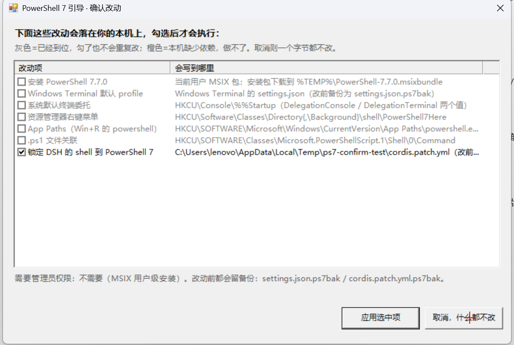

# ps7-bootstrap

让 Windows 上的 DSH 用 **PowerShell 7** 跑命令，而不是开机就在的 5.1。

## 为什么需要这个

DSH 的 shell 插件（`@deepseek-ai/dsh-pwsh-sandbox`）在 **进程启动时** 按固定顺序找可执行文件：

1. `C:\Program Files\PowerShell\7\pwsh.exe`
2. `PATH` 里每个目录下的 `pwsh.exe`
3. 兜底：`C:\Windows\System32\WindowsPowerShell\v1.0\powershell.exe`（就是 5.1）

新机器上没装 PS7，第 3 项必然命中，于是 DSH 里所有命令都跑在 5.1 上：`??`、`?.`、三元运算、`&&`、`ForEach-Object -Parallel` 全部不认识，脚本还会因为 5.1 默认的 `Restricted` 执行策略被拒。

## 新机器两步

前提：这台机器上 **DSH 已经装好并能正常启动**（否则没有 `plugin_manager`）。

1. **解压** 本目录到任意位置，例如 `D:\ps7-bootstrap`。
2. **装插件**：在 DSH 里执行
   ```
   plugin_manager(action: "install_bundle", target: "D:\\ps7-bootstrap")
   ```

**第三步是看一张确认卡。** 插件加载后约 2 秒会先算一份清单：本机已装什么、还差什么、每一项会写到哪里。只要还有待改的项，就会弹一个窗口把清单摊开——每行写明「会写哪个文件 / 哪个注册表键」，默认勾选待改项，你自己决定勾哪几行，点「应用选中项」才动手；点「取消，什么都不改」则一个字节都不写。



已经配置好的机器连窗口都不会弹（两次文件探测就判定就绪）。想确认结果、或者不想等自动流程：

```
ps7_bootstrap(action: "plan")      # 只读，列出会改什么、现在什么状态
ps7_bootstrap(action: "confirm")   # 弹确认窗口，勾选后执行（默认动作）
ps7_bootstrap(action: "verify")    # 只读，看四项是否都 ✓
```

不需要重启 DSH：profile 的 patch 层是热重载的，`pwshPath` 的 getter 比对到配置变化会立即重新解析。

### 想改自动行为

在 profile 的 `cordis.patch.yml` 里给本插件加配置：

```yaml
- id: ps7-bootstrap-tool
  name: ps7-bootstrap
  config:
    autoRun: ask           # 默认：弹确认窗口，勾选后才改
    # autoRun: off         # 加载时完全不动，全靠手动调工具
    # autoRun: lock-only   # 只锁 pwshPath，不下载、不碰终端和注册表
    # autoRun: full        # 旧行为：不问，缺什么补什么（无人值守机器才这么配）
```

自动引导不阻塞启动，失败也不影响 DSH——结果只记在模块内的 `lastAutoRun` 里。

## 它到底改了什么

| 步骤 | 动作 | 作用域 |
| --- | --- | --- |
| `plan` | 只读列出 7 个候选改动项：状态（已就绪/待改动/无法执行）+ 落点 | 只读 |
| `confirm` | 弹确认窗口，逐行展示落点，勾选后才执行；取消即零改动 | 由用户勾选决定 |
| `detect` | 查 PS7 是否已装、别名是否存在、各项注册表当前值 | 只读 |
| `install` | 下载 `PowerShell-7.7.0.msixbundle` 并 `Add-AppxPackage` | 用户级，**不需要管理员** |
| `integrate` | 终端委托、WT 默认 profile、右键菜单、App Paths、`.ps1` 关联 | 全部 HKCU |
| `lock` | 在 DSH profile 的 `cordis.patch.yml` 里写死 `pwshPath` | 只写当前 profile |
| `verify` | **实跑**四项，不只看注册表有没有键 | 只读 |
| `auto` / `all` | 不问用户的批量路径，只在明确要求时用 | 视缺口而定 |

`lock` 是真正让「DSH 不打架」的那一步。只装插件不跑 `lock`，命令照样跑在 5.1 上。

## 几个可能踩的点

**网络**：GitHub 直连在国内常年不通。`install` 会按 `ghproxy.net` → `gh-proxy.com` → `ghfast.top` → 直连 的顺序轮询，哪个能下用哪个。全都失败时会明确报错，不会留下半个文件（下载先落 `.tmp`，校验 SHA256 后才 `Add-AppxPackage`）。

**多个 profile**：`lock` 按 `-ProfileDir` → `DSH_PROFILE_DIR` → 唯一 profile → `DSH_PROFILE` → 最近修改 的顺序定位 `cordis.patch.yml`，并在结果里打印命中的 profile 名（`profile [desktop] 已锁定 ...`）。写错目录的话这一行能立刻看出来。

**DSH 版本差异**：如果这个版本的 DSH 根本没有 `dsh-pwsh-sandbox` 插件，`lock` 会打一条 `[WARN]` 提示锁定可能无效——因为 `pwshPath` 是这个插件的配置项，插件不在，配置就没人认领。

**执行策略**：MSIX 版 PS7 的 `ExecutionPolicy` 是 `RemoteSigned`，`Add-AppxPackage` 不碰这个值，不用担心被改。

## 回退

| 想撤销 | 怎么做 |
| --- | --- |
| 只撤销 DSH 的锁定 | 删掉 `cordis.patch.yml` 里的 `- id: pwsh-sandbox` 那整段 |
| 撤销终端/右键/App Paths | 跑 `ps7-bootstrap.ps1 -Action integrate` 之前会自动备份为 `*.ps7bak`，覆盖回去 |
| 不想要 PS7 本身 | `Get-AppxPackage Microsoft.PowerShell \| Remove-AppxPackage` |

`lock` 每次写入前会把原文件存成 `cordis.patch.yml.ps7bak`；如果已经存在 `pwsh-sandbox` 条目则直接跳过，不会重复追加。

## 直接跑脚本（不装插件）

脚本本身不依赖 DSH，任何 5.1 或 7 的会话里都能跑：

```powershell
powershell.exe -NoProfile -ExecutionPolicy Bypass -File .\scripts\ps7-bootstrap.ps1 -Action all
```

可选参数：`-Version 7.7.0`、`-Mirror <url>`、`-ProfileDir <dir>`、`-Force`（PS7 已装仍强制重下）。
